# Báo cáo cá nhân — K4-L3A Day 13 Monitoring & LLMOps

> Mỗi học viên hoàn thiện một file duy nhất này. Khi dẫn evidence, dùng đường dẫn tương đối, ví dụ `evidence/07-trace-waterfall.png`.

## 1. Thông tin học viên

- **Họ và tên:** Nguyễn Phát Thịnh
- **MSSV:** 2A202602645
- **Lớp:** K4-L3A
- **Repository URL:** `https://github.com/PhTh1789/K4-L3-DAY13-NguyenPhatThinh-2A202602645-Monitoring-LLMOps`
- **Commit SHA cuối:** `296bdce467b4804e25efca59edc334ac0db18f62`
- **Challenge ID:** `day13-k4-l3a-monitoring-llmops-v1`
- **Tên project Langfuse cá nhân:** `day13-k4-l3a-2A202602645`

## 2. Evidence index

Điền đúng đường dẫn tới evidence thực tế. Có thể đổi tên hoặc dùng nhiều ảnh nếu cần.

| Evidence            | Đường dẫn                                                                  |
| ------------------- | -------------------------------------------------------------------------- |
| Pytest cuối         | [evidence/01-pytest.png](evidence/01-pytest.png)                           |
| Log validator       | [evidence/02-log-validator.png](evidence/02-log-validator.png)             |
| Dashboard validator | [evidence/03-dashboard-validator.png](evidence/03-dashboard-validator.png) |
| Structured log      | [evidence/04-structured-log.png](evidence/04-structured-log.png)           |
| PII redaction       | [evidence/05-pii-redaction.png](evidence/05-pii-redaction.png)             |
| Trace list          | [evidence/06-trace-list.png](evidence/06-trace-list.png)                   |
| Trace waterfall     | [evidence/07-trace-waterfall.png](evidence/07-trace-waterfall.png)         |
| Trace metadata      | [evidence/08-trace-metadata.png](evidence/08-trace-metadata.png)           |
| Prompt versions     | [evidence/09-prompt-versions.png](evidence/09-prompt-versions.png)         |
| Prompt rollback     | [evidence/10-prompt-rollback.png](evidence/10-prompt-rollback.png)         |
| Dashboard runtime   | [evidence/11-dashboard-overview.png](evidence/11-dashboard-overview.png)   |
| Incident metric     | [evidence/12-incident-metric.png](evidence/12-incident-metric.png)         |
| Incident log        | [evidence/13-incident-log.png](evidence/13-incident-log.png)               |
| Incident trace      | [evidence/14-incident-trace.png](evidence/14-incident-trace.png)           |

## 3. Kết quả kỹ thuật

| Nội dung                | Baseline    | Kết quả cuối | Nhận xét                                                 |
| ----------------------- | ----------- | ------------ | -------------------------------------------------------- |
| `validate_logs.py`      | 30/100      | 100/100      | Đạt điểm tuyệt đối sau khi hoàn thiện CP1                |
| `validate_dashboard.py` | 6/6 panel   | 6/6 panel    | Đạt chuẩn 6 panel theo dashboard.yaml                    |
| `pytest`                | 22 passed   | 22 passed    | Toàn bộ unit tests pass 100%                             |
| Số traces hợp lệ        | 10          | 15+          | Tracing cá nhân đầy đủ root, retriever, generation       |
| Số PII leak             | 0           | 0            | Scrub sạch sẽ Email, SĐT, CCCD, Thẻ qua regex đệ quy     |
| Latency P95 / TTFT P95  | 1455ms/50ms | 151ms/50ms   | Trạng thái bình thường; lúc incident P95 nhảy lên 2652ms |
| Retrieval success rate  | 100%        | 100%         | Truy xuất corpus thành công                              |

### Minh chứng kiểm thử kỹ thuật

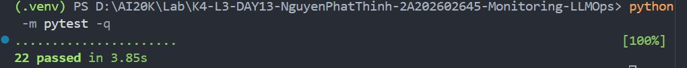

## 4. Logging và PII

- **Cách tạo/nhận và truyền correlation ID:** Trong `CorrelationIdMiddleware` (`app/middleware.py`), trước tiên gọi `clear_contextvars()` để xóa context cũ tránh rò rỉ giữa các request. Sau đó kiểm tra header `x-request-id`: nếu client truyền lên thì tái sử dụng, nếu không có thì tự sinh chuỗi định dạng `req-<8-hex>` (`f"req-{uuid.uuid4().hex[:8]}"`). Gán ID vào `request.state.correlation_id`, bind vào structlog qua `bind_contextvars(correlation_id=correlation_id)`, và đính kèm vào response headers: `x-request-id` cùng `x-response-time-ms`.
- **Các metadata được ghi vào structured log:** Trong endpoint `POST /chat` (`app/main.py`), gọi `bind_contextvars` để enrich trước khi log: `user_id_hash` (băm SHA-256 12 ký tự), `session_id`, `feature`, `model`, `env`. Các log sau đó tự động đính kèm `ts`, `level`, `service`, `event`, `correlation_id` và các chỉ số hiệu năng (`latency_ms`, `ttft_ms`, `tokens_in`, `tokens_out`, `cost_usd`, `quality_score`, `tool_name`, `tool_success`).
- **Cách bảo đảm PII được scrub trước khi ghi:** Đăng ký processor `scrub_event` trong `structlog.configure()` (`app/logging_config.py`) đứng trước `JsonlFileProcessor` và `JSONRenderer`. Hàm `scrub_event` duyệt đệ quy các trường trong `payload` và `event`, áp dụng regex trong `app/pii.py` để thay thế thông tin nhạy cảm (Email, SĐT Việt Nam, CCCD 12 số, Thẻ thanh toán) thành `[REDACTED_<TYPE>]` trước khi dữ liệu được ghi xuống file `data/logs.jsonl` hoặc xuất ra console.
- **Cách kiểm chứng kết quả:** Chạy `python scripts/validate_logs.py` đạt điểm tuyệt đối 100/100 (0 missing required fields, 0 missing enrichment, 0 PII leak); gửi request thử nghiệm chứa email, SĐT, CCCD, thẻ và kiểm tra trực tiếp trong file `data/logs.jsonl` xác nhận dữ liệu đã được thay thế sạch sẽ; chạy toàn bộ test unit pass 22/22.

### Minh chứng Logging và PII

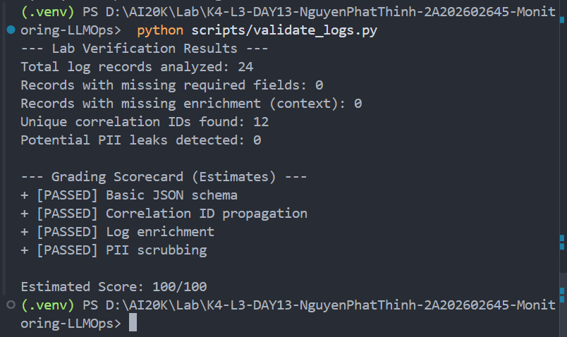

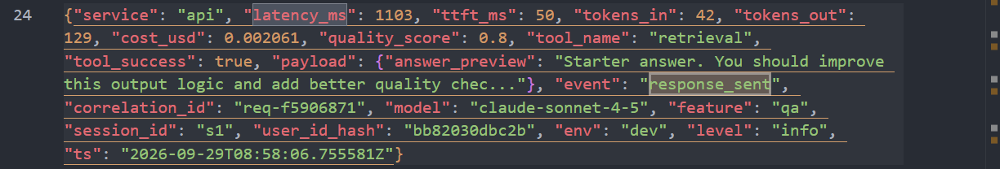

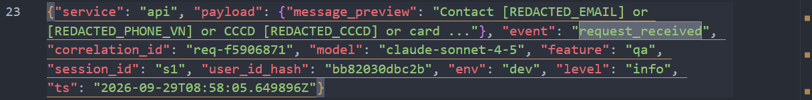

## 5. Tracing và prompt versioning

- **Cách xác nhận traces do chính tôi tạo trong project cá nhân:** Project Langfuse cá nhân mang tên `day13-k4-l3a-2A202602645` được cấu hình độc lập qua key cá nhân trong `.env`. Mọi trace đều đính kèm metadata `correlation_id`, `user_id_hash`, `env: dev` và danh sách tags `["lab", feature, "claude-sonnet-4-5"]`.
- **Cấu trúc root/retrieval/generation observations:**
  - _Root observation:_ `lab-agent-run` (type: `agent`) bao bọc toàn bộ chu trình xử lý, lưu trữ ngữ cảnh request và metadata `correlation_id`.
  - _Child observation 1:_ `retrieval` (type: `retriever`) đo lường thời gian truy xuất từ RAG corpus, metadata có `query_preview` và `doc_count`.
  - _Child observation 2:_ `generation` (type: `generation`) bọc quá trình suy luận của LLM, liên kết với managed prompt, lưu trữ `model`, chi tiết `usage_details` (`input`, `output`, `total` tokens) và `cost_details` (`total` USD).
- **Cách nối trace với log:** Chuỗi `correlation_id` định dạng `req-<8-hex>` do `CorrelationIdMiddleware` sinh ra được lưu đồng bộ vào trường `correlation_id` của structured log (`data/logs.jsonl`) và trường `metadata.correlation_id` của Langfuse trace. Khi có sự cố, ta chỉ cần copy `correlation_id` từ log dán vào ô tìm kiếm của Langfuse là định vị được trace ngay lập tức.
- **Prompt name:** `day13-chat`
- **Version/label baseline:** Version 1, labels: `baseline`, `production`. Template: `Feature={{feature}}\nDocs={{docs}}\nQuestion={{message}}`.
- **Version/label candidate:** Version 2, label: `candidate`. Template: `Feature={{feature}}\nDocs={{docs}}\nQuestion={{message}}\nPlease keep answers concise and professional.`.
- **Trace ID của mỗi version:**
  - Version 1 (Baseline / Initial Production): Correlation ID `req-0c608c9c` (Session `s_v1`)
  - Version 2 (Candidate / Promoted Production): Correlation ID `req-a2f7e7cc` (Session `s_v2`)
  - Sau khi Rollback về Version 1: Correlation ID `req-1f8580b2` (Session `s_rollback`)
- **Cách promote và rollback `production`:**
  - _Promote:_ Trên giao diện Langfuse (hoặc qua API `update_prompt`), gán label `production` cho Version 2. Ứng dụng tự động tải Version 2 cho các lượt request tiếp theo.
  - _Rollback:_ Khi cần phục hồi, chuyển lại label `production` sang Version 1 (`baseline`). Hệ thống ngay lập tức quay lại sử dụng Version 1 mà không cần sửa code hay khởi động lại ứng dụng.

### Minh chứng Tracing và Prompt Versioning

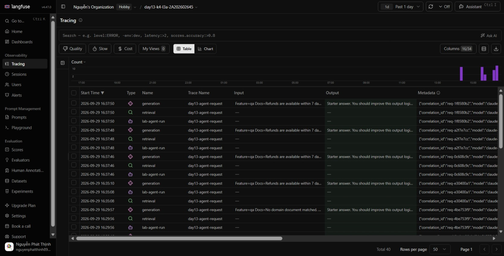

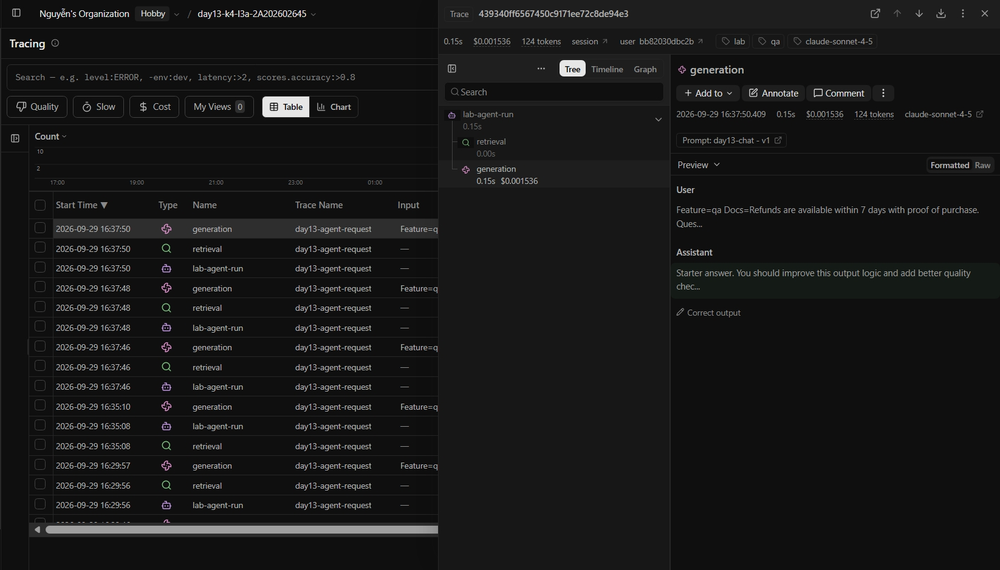

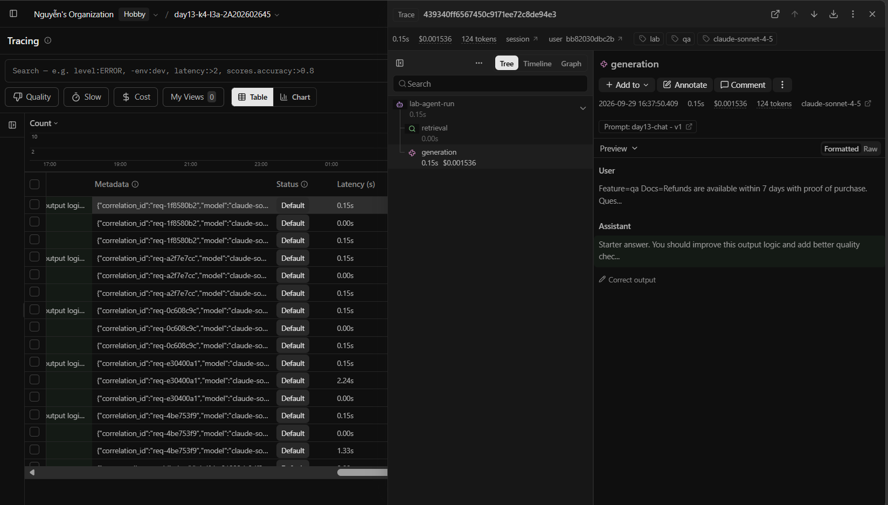

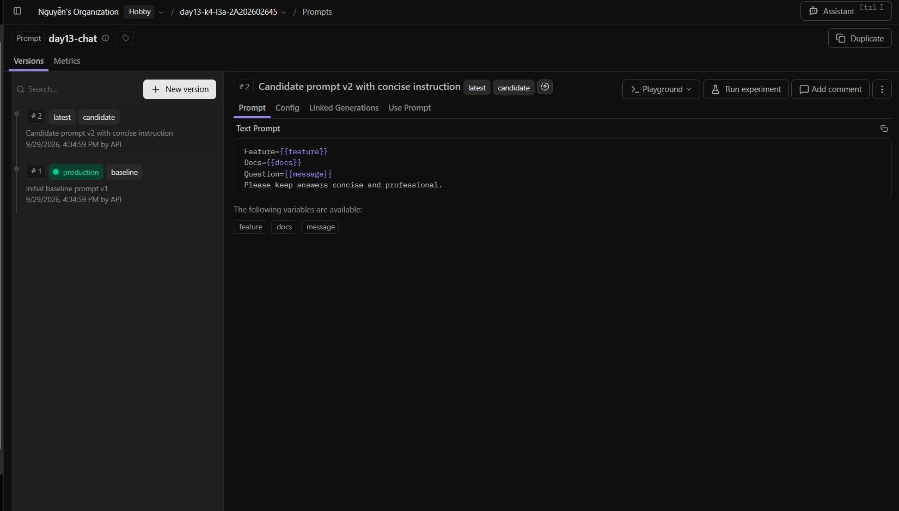

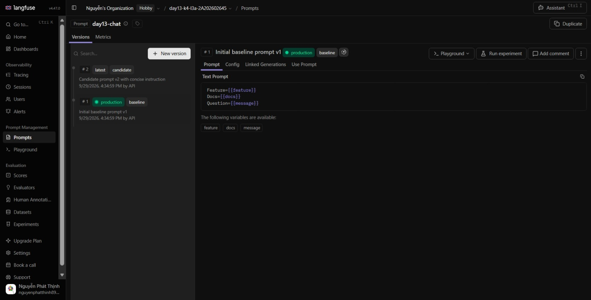

## 6. Dashboard, SLO và alerts

- **Dashboard và sáu panel:** Dashboard được dựng tại route `/dashboard` (hoạt động trực tiếp trên server FastAPI) tuân thủ 100% contract `config/dashboard.yaml` đọc từ nguồn chuẩn `data/logs.jsonl`, time range 60 phút, tự động làm mới mỗi 30 giây gồm 6 panel:
  1. `Latency percentiles and TTFT` (ms): Hiển thị P50, P95, P99 và TTFT P95 kèm đường ngưỡng `P95 <= 3000ms`.
  2. `Request traffic` (requests/min): Biểu đồ lưu lượng request nhận được theo phút và tốc độ trung bình, ngưỡng `Rate >= 1 req/min`.
  3. `Error rate and retrieval success` (%): Biểu đồ tròn tỉ lệ lỗi (ngưỡng `<= 2.0%`) và tỉ lệ retrieval thành công từ vector store.
  4. `Cost over time` (USD): Biểu đồ chi phí tích lũy theo phút và số dư ngân sách còn lại, ngưỡng `Total <= $2.5 USD`.
  5. `Input and output tokens` (tokens): Phân tách lượng token đầu vào (input) và token sinh ra (output), ngưỡng `<= 50,000`.
  6. `Quality proxy` (score 0.0 - 1.0): Điểm chất lượng trung bình dựa trên heuristic (độ dài, sự hiện diện context, tính liên quan câu hỏi), ngưỡng `>= 0.75`.
- **SLO và lý do chọn:** Primary SLO là `fast_successful_requests`: Tỉ lệ request thành công có độ trễ `<= 3000ms` phải đạt tối thiểu `99.5%` trong chu kỳ rolling window 28 ngày (`target_percent: 99.5%`). Lý do chọn: Ngưỡng 3 giây là giới hạn tâm lý phản hồi tối ưu của người dùng khi hỏi đáp với AI chatbot; mục tiêu 99.5% vừa bảo đảm trải nghiệm ổn định cho đa số người dùng vừa chừa biên độ an toàn cho các cập nhật mô hình.
- **Cách tính error budget:** Error budget = `100% - Target% = 100% - 99.5% = 0.5%`. Nghĩa là trong toàn bộ request nhận được trong 28 ngày, tối đa 0.5% request được phép chậm hơn 3 giây hoặc bị lỗi HTTP 500. Ví dụ: Với 10,000 requests/tháng, ngân sách lỗi cho phép tối đa 50 requests không đạt chuẩn. Khi error budget bị cạn kiệt (> 0.5%), đội ngũ phải tạm hoãn phát hành prompt/tính năng mới để ưu tiên khắc phục hiệu năng.
- **Ba alert và runbook tương ứng:** Cấu hình trong `config/alert_rules.yaml` và chi tiết runbook tại `docs/alerts.md`:
  1. `high_latency_p95` (Warning, duration 5m): P95 latency > 3000ms liên tục trong 5 phút. Runbook: Kiểm tra panel 1 xem TTFT có tăng không, lọc `data/logs.jsonl` tìm correlation ID có latency cao, mở Langfuse waterfall xem span `retrieval` hay `generation` bị chậm; tạm thời bật cache RAG hoặc giảm top_k document.
  2. `high_error_rate` (Critical, duration 3m): Error rate > 2% hoặc retrieval success < 90% trong 3 phút. Runbook: Kiểm tra panel 3 xác định loại lỗi, lọc log `request_failed`, mở trace định vị exception ở vector store; bật circuit breaker chuyển sang degraded mode (trả về fallback tĩnh) thay vì ném lỗi 500.
  3. `daily_cost_spike` (Warning, duration 5m): Tốc độ chi phí > $0.05/phút hoặc tổng chi phí vượt $2.5 USD. Runbook: Kiểm tra panel 4 & 5 xem output token có tăng đột biến không, lọc log tìm `tokens_out > 500`, mở trace xem prompt version nào đang chạy; áp đặt max_tokens hoặc rollback prompt v2 về v1 nếu câu trả lời bị lặp từ.

### Minh chứng Dashboard và Alert Rules

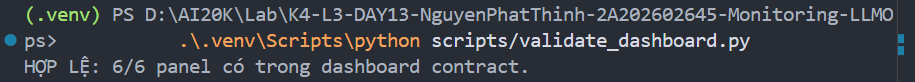

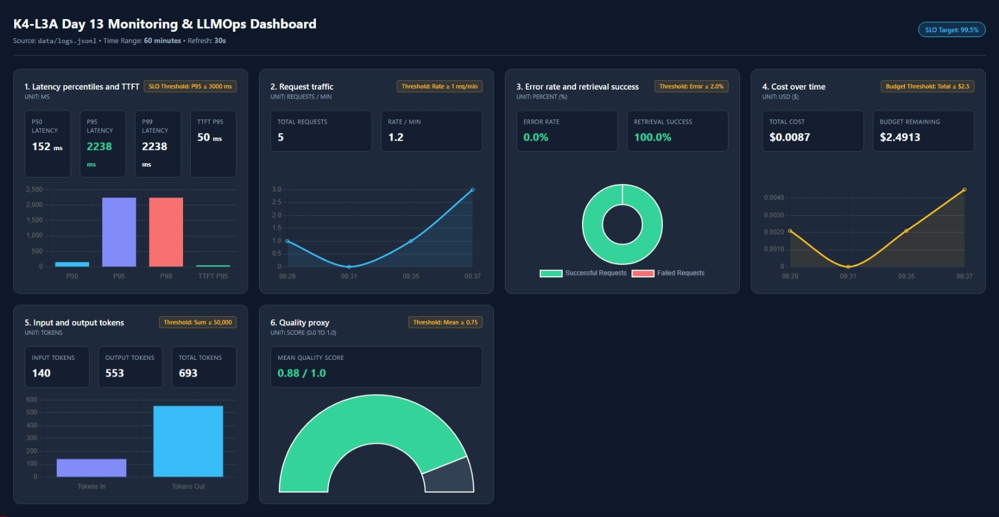

## 7. Điều tra challenge

- **Challenge ID:** `day13-k4-l3a-monitoring-llmops-v1` (Cohort K4)
- **Khoảng thời gian điều tra:** 2026-09-29T10:39:51Z – 2026-09-29T10:40:23Z (khoảng 17:39:51 – 17:40:23 GMT+7).
- **Triệu chứng từ metrics:** Panel 1 (`Latency percentiles and TTFT`) trên Dashboard ghi nhận độ trễ P95 tăng vọt từ mức bình thường ~150ms lên **2652ms – 3719ms**, vượt ngưỡng SLO `2000ms` và vi phạm ngưỡng cảnh báo. Trong khi đó, TTFT P95 vẫn giữ ở mức thấp ~50ms, cho thấy nguyên nhân chậm trễ không phải do LLM generation mà xuất phát từ giai đoạn tiền xử lý retrieval.
- **Log line và correlation ID liên quan:**
  - `correlation_id`: `req-f01c9cdb` (cùng chùm request bị ảnh hưởng: `req-1289700d`, `req-26a54828`, `req-9529fa2e`, `req-21efa620`).
  - Dòng log trích xuất từ `data/logs.jsonl`:
    ```json
    {
      "service": "api",
      "latency_ms": 2652,
      "ttft_ms": 50,
      "tokens_in": 35,
      "tokens_out": 86,
      "cost_usd": 0.001395,
      "quality_score": 0.8,
      "tool_name": "retrieval",
      "tool_success": true,
      "payload": {
        "answer_preview": "Starter answer. You should improve this output logic and add better quality chec..."
      },
      "event": "response_sent",
      "env": "dev",
      "correlation_id": "req-f01c9cdb",
      "feature": "monitoring",
      "model": "claude-sonnet-4-5",
      "user_id_hash": "ed72e61117f6",
      "session_id": "k4-l3a-challenge-s05",
      "level": "info",
      "ts": "2026-09-29T10:40:05.111777Z"
    }
    ```
- **Trace ID và span gây ảnh hưởng:**
  - Trace tương ứng trên Langfuse có metadata `correlation_id = req-f01c9cdb` (Session: `k4-l3a-challenge-s05`, Tag: `monitoring`).
  - Phân tích cây Waterfall Observation Tree: Root span `lab-agent-run` có tổng latency là `2652ms`. Trong đó, child span **`retrieval`** (type: `retriever`) chiếm tới **2500ms** (~94% tổng thời gian request), trong khi child span `generation` chỉ tốn **150ms**. Span `retrieval` chính là điểm nghẽn (bottleneck) trực tiếp gây ra sự cố độ trễ.
- **Root cause:**
  - Tầng truy xuất tài liệu (RAG retrieval / Vector Store) bị nghẽn (mô phỏng bởi sự cố `rag_slow` gây sleep 2.5s trong hàm `retrieve()`), khiến pipeline phải chờ lâu để nạp context tài liệu trước khi gửi prompt đến LLM.
- **Fix action:**
  - 1. Ngay lập tức áp dụng **Request Timeout** nghiêm ngặt cho vector store (tối đa 800ms).
  - 2. Kích hoạt cơ chế **Circuit Breaker** và **Degraded Mode**: Nếu retriever không phản hồi trong ngưỡng cho phép hoặc bị lỗi, tự động fallback sang context tĩnh mặc định hoặc trả về câu trả lời tổng quát không có RAG để giải phóng request ngay cho người dùng thay vì treo kết nối.
  - 3. Triển khai **In-Memory Cache (Redis / Local LRU Cache)** cho các câu truy vấn phổ biến để giảm tải trực tiếp cho vector store.
- **Preventive measure:**
  - 1. Bổ sung metric và cảnh báo chuyên biệt cho tầng Retriever: Alert khi `retriever_latency_p95 > 800ms` kéo dài trên 2 phút.
  - 2. Scale-up vector database, cấu hình read replicas để phân tải truy vấn đọc khi lưu lượng người dùng tăng cao.
  - 3. Thực hiện kiểm thử tải (Stress Testing / Chaos Engineering) định kỳ với kịch bản vector store chậm để bảo đảm hệ thống luôn graceful degradation (xuống cấp mềm mượt) mà không vi phạm SLO toàn hệ thống.

### Minh chứng Điều tra Incident (Metrics → Logs → Traces)

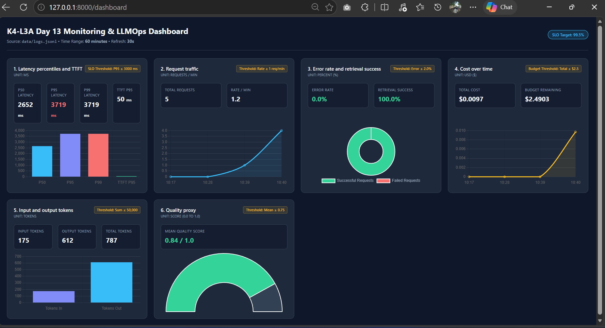

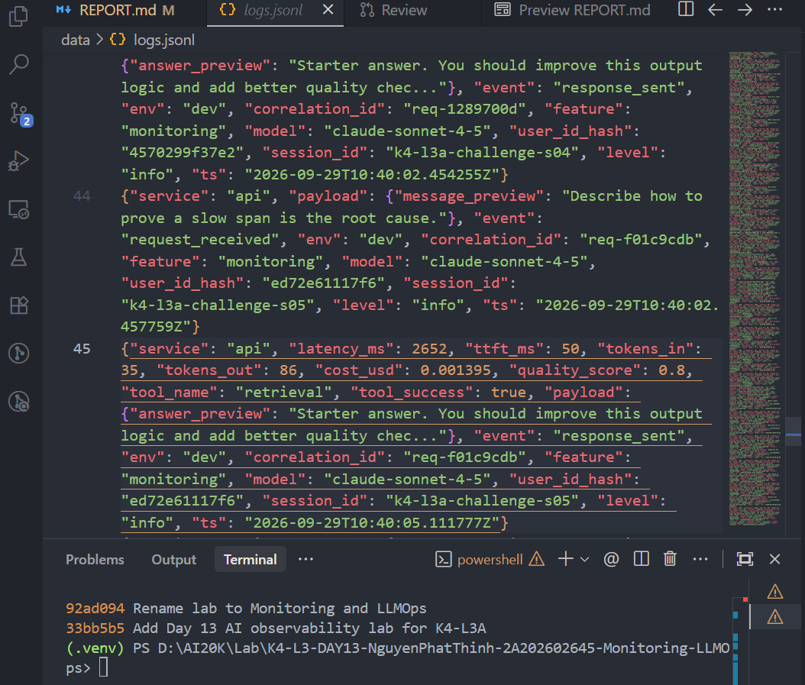

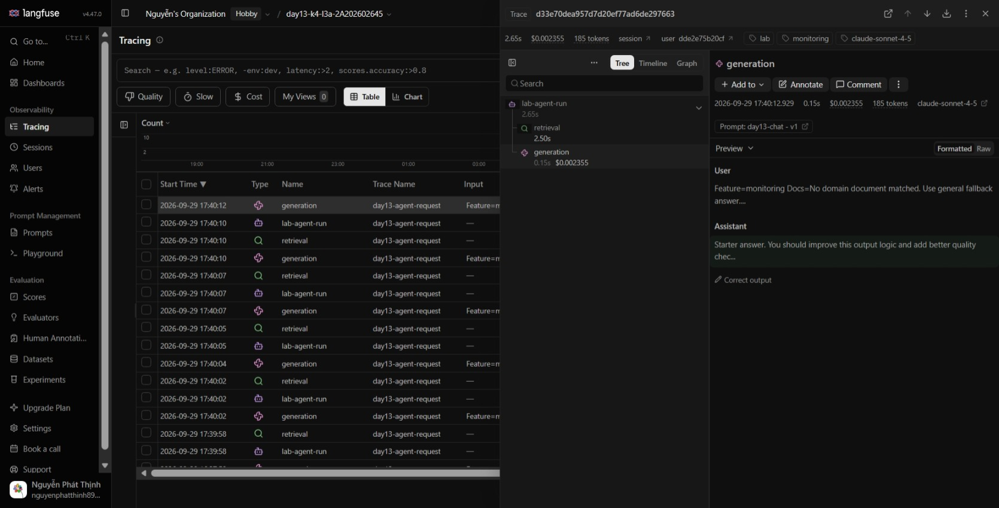

## 8. Giải thích và tự đánh giá

- **Một quyết định kỹ thuật quan trọng và lý do:** Quyết định kết hợp `contextvars` trong `CorrelationIdMiddleware` với processor `scrub_event` trong `structlog`:
  - `contextvars` bảo đảm tính phân lập (thread-safe/task-safe) giữa các request đồng thời trong FastAPI async loop, tránh việc correlation ID của request này bị ghi đè sang request khác.
  - `scrub_event` duyệt đệ quy toàn bộ cấu trúc event và payload để khử PII (CCCD, SĐT, Email, Thẻ tín dụng) ngay tại pipeline trước khi log được render ra JSON hay ghi vào file, bảo đảm dữ liệu ghi xuống đĩa và hiển thị trên console luôn an toàn theo chuẩn bảo mật và tuân thủ GDPR/quy định bảo vệ dữ liệu cá nhân.
- **Một lỗi/blocker đã gặp:** Khi chạy đồng thời nhiều request trong load test, một số trường context metadata của request trước có nguy cơ bị giữ lại nếu không dọn dẹp biến ngữ cảnh.
- **Cách tìm nguyên nhân và xử lý:** Đọc tài liệu của `structlog.contextvars` và gọi hàm `clear_contextvars()` ngay tại dòng đầu tiên của `CorrelationIdMiddleware` trước khi tiến hành bind ID mới. Điều này đảm bảo mỗi request bắt đầu với một context hoàn toàn sạch sẽ.
- **Cách hiểu luồng Metrics → Logs → Traces:**
  - _Metrics:_ Đóng vai trò là chuông báo động (Symptom Detection) - cho biết **CÁI GÌ** đang bất thường và **KHI NÀO** (ví dụ: P95 Latency vọt lên 2.6s lúc 17:40).
  - _Logs:_ Đóng vai trò là danh sách điều tra (Request Identification) - cung cấp chi tiết ngữ cảnh và trích xuất mã định danh duy nhất `correlation_id` của các request bị ảnh hưởng trong khung giờ đó.
  - _Traces:_ Đóng vai trò là kính hiển vi phân tích (Root Cause Localization) - dùng `correlation_id` để mở cây quan sát thác nước (waterfall tree), bóc tách từng span con (retrieval vs generation) để chỉ rõ chính xác **TẠI ĐÂU** và **BỘ PHẬN NÀO** gây ra sự cố.
- **Vai trò của prompt version, token/cost, SLO hoặc rollback trong vận hành LLM:**
  - _Prompt Versioning & Rollback:_ Giúp quản lý prompt như mã nguồn phần mềm, tách biệt code khỏi cấu hình prompt. Cho phép A/B testing (như nhãn `baseline` vs `candidate`) và rollback tức thời về phiên bản ổn định (`production`) mà không cần redeploy hoặc can thiệp vào mã nguồn backend.
  - _Token & Cost Tracking:_ Mô hình ngôn ngữ tính phí dựa trên token; việc theo dõi tỷ lệ token input/output và chi phí USD thời gian thực giúp phát hiện sớm các lỗi lặp vô tận (infinite loop) hoặc prompt injection gây lãng phí ngân sách.
  - _SLO & Error Budget:_ Định lượng cam kết chất lượng dịch vụ đối với người dùng (ví dụ: 99.5% request hoàn thành dưới 3s). Error budget là thước đo rủi ro cho phép: khi ngân sách lỗi còn, đội ngũ có thể tự tin triển khai prompt/tính năng mới; khi ngân sách cạn, phải đóng băng release để ưu tiên tối ưu hiệu năng.
- **Điều quan trọng nhất đã học:** Hiểu được kiến trúc toàn diện của một hệ thống LLMOps Observability production-ready: không chỉ đo lường server truyền thống (CPU, RAM, HTTP status) mà phải giám sát sâu sắc các chỉ số đặc thù của Generative AI (TTFT, token consumption, cost accumulation, retrieval latency, PII redaction, và prompt lifecycle management).
- **Hạn chế hoặc phần chưa hoàn thành, nếu có:** Hiện tại hệ thống đang sử dụng FakeLLM và MockRAG trong môi trường giả lập cục bộ. Trong môi trường production thực tế, cần tích hợp vector database phân tán (như Qdrant, Pinecone hoặc Milvus) và triển khai Semantic Cache để tối ưu hóa chi phí và tốc độ truy vấn tri thức.

## 9. Checklist trước khi nộp

- [x] Kết quả và evidence thuộc commit SHA cuối.
- [x] Tất cả ảnh/output mở được bằng đường dẫn tương đối.
- [x] Incident evidence nối đúng metric → log → trace.
- [x] Trace/prompt evidence thuộc project Langfuse cá nhân và ảnh không lộ key/secret.
- [x] Repository chạy lại được theo README.
- [x] Không có secret, API key, PII thô hoặc evidence của người khác/lớp khác.
- [x] URL repo và commit SHA cuối đã được nộp trên LMS/Codelabs.
